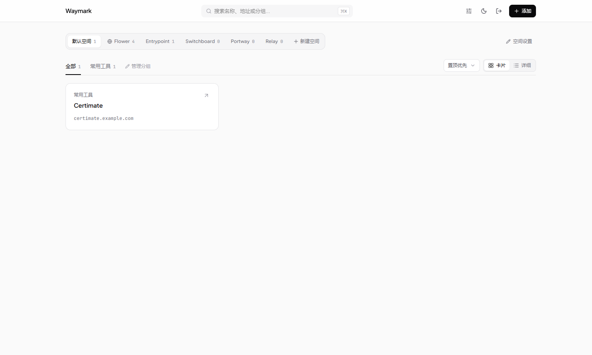
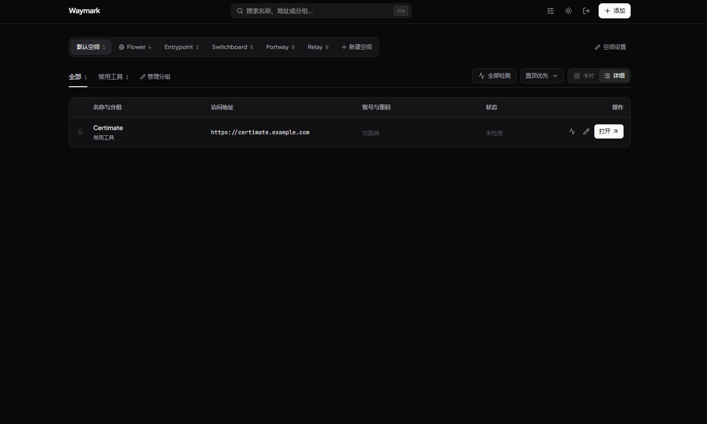

# Waymark

**Waymark** 是一个极简、优雅的多工作空间统一入口导航与站点管理台。

你可以按业务线、使用场景、团队或个人习惯自由划分不同的**工作空间（Workspace）**，统一整理各类常用网站、内部系统、云服务、文档库、监控面板或后台管理入口；同时支持将指定工作空间通过**自定义路由**或**独立域名**对外公开分享，并严格隔离访问权限。

---

## 界面预览






---

## 核心特性

- **多工作空间自由组织**：支持创建多个独立工作空间，自定义空间名称、说明与图标；每个空间拥有独立的分组体系、站点列表、视图模式（卡片 / 详细表格）与置顶排序，不绑定特定系统类型。
- **双模式公开访问（自定义路由 + 独立域名）**：
  - **自定义路由**：为工作空间设置专属路径（例如 `/team`、`/tools`），即可通过 `https://your-domain.com/team` 直接访问。
  - **独立域名**：为工作空间绑定独立域名（例如 `nav.example.com`），配置 DNS 解析与反向代理后，访问该域名根路径 `/` 即可直达对应公开空间。
  - **严格只读隔离**：公开页面与接口仅返回站点名称、访问地址、分组与备注说明，彻底隔离安全入口、账号密码、自动登录信息与任何后台管理操作。
- **按需自动登录与快捷操作**：
  - 站点默认作为轻量导航入口使用，无需填写多余凭据；仅在开启「启用自动登录」后，按需配置入口路径与账号密码。
  - 管理台卡片支持一键快捷复制**访问地址**、**用户名**与**密码**；配合专用 **Waymark 浏览器插件**（`/waymark-extension.zip`，推荐）或 **Tampermonkey 油猴脚本**（`/waymark-bridge.user.js`，备选），支持一键打开目标站点并自动填充表单登录；Nginx 等 HTTP Basic 认证通过启动链接携带凭据由浏览器原生完成。
- **轻量、安全与可移植**：
  - **管理员会话鉴权**：管理控制台需管理员登录后访问，密码通过 Node.js `crypto.scrypt` 加盐哈希存储，会话采用 HMAC-SHA256 签名 Cookie 校验。
  - **服务端持久化与跨端同步**：工作空间与站点数据持久保存于服务端 `DATA_DIR`（`/app/data`），切换 IP、域名或设备登录均可自动同步；支持设置本地主密码二次保护。
  - **批量导入导出**：支持 CSV 与 JSON 两种格式的站点导入、导出及全量备份恢复。

---

## 快速部署

### Docker 部署（推荐）

每次推送代码时，GitHub Actions（`.github/workflows/docker-publish.yml`）会自动构建镜像并推送至 GitHub Container Registry（GHCR），同时生成 `<7位CommitID>-<UTC时间戳>` 与 `latest` 两个标签。

```bash
docker run -d \
  --name waymark \
  -p 3000:3000 \
  -v $(pwd)/data:/app/data \
  -e ADMIN_USERNAME=admin \
  -e ADMIN_PASSWORD=change_me_strong_password \
  -e SESSION_SECRET=$(openssl rand -hex 32) \
  ghcr.io/<your-github-username>/<your-repo-name>:latest
```

或使用 `docker-compose.yml`：

```yaml
services:
  waymark:
    image: ghcr.io/<your-github-username>/<your-repo-name>:latest
    container_name: waymark
    restart: unless-stopped
    ports:
      - "3000:3000"
    volumes:
      - ./data:/app/data
    environment:
      PORT: 3000
      DATA_DIR: /app/data
      # 可选：若未配置环境变量，首次访问 Web 页面时将引导初始化管理员账号
      ADMIN_USERNAME: admin
      ADMIN_PASSWORD: change_me_strong_password
      SESSION_SECRET: replace_with_random_hex_secret
```

#### 环境变量说明

| 变量名 | 默认值 | 说明 |
| :--- | :--- | :--- |
| `PORT` | `3000` | 服务监听端口 |
| `DATA_DIR` | `./data`（Docker 中为 `/app/data`） | 服务端持久化目录，保存管理员账号配置、全部工作空间与站点数据及公开空间只读索引 |
| `ADMIN_USERNAME` | 未设置 | 可选，预设管理员用户名；未设置时首次访问页面可在界面引导创建 |
| `ADMIN_PASSWORD` | 未设置 | 可选，预设管理员密码；与 `ADMIN_USERNAME` 配合使用 |
| `SESSION_SECRET` | 随机生成 | 建议在生产环境显式指定固定随机字符串，避免重启容器后登录态失效 |

#### 方式三：Cloudflare Pages 部署

项目已内置 **Cloudflare Pages Functions**（`/functions/api/[[path]].ts`）与构建期静态资源打包（自动生成 `dist/waymark-extension.zip` 与 `dist/waymark-bridge.user.js`）：

1. 在 Cloudflare Pages 创建项目并连接 Git 仓库：
   - **构建命令（Build command）**：`npm run build`
   - **构建输出目录（Build output directory）**：`dist`
2. **存储与认证模式（二选一）**：
   - **跨设备云端同步模式（推荐）**：在 Cloudflare Pages 项目设置 → **Functions** → **KV 命名空间绑定（KV namespace bindings）** 中，添加变量名为 `WAYMARK_KV` 的 KV 命名空间。绑定后，管理员账号、工作空间、节点配置与公开工作空间将持久保存在 Cloudflare KV 中。
   - **零配置本地模式**：若未绑定 `WAYMARK_KV`，系统会自动降级为浏览器本地加密存储模式（基于 Web Crypto 哈希校验与 `localStorage`），不会出现 `405 Method Not Allowed` 报错，同样支持创建管理员、登录及下载浏览器插件。

---

### 反向代理与独立域名配置

如果为某个公开工作空间配置了**独立访问域名**（例如 `portal.example.com`），请将域名 DNS 解析至服务器，并在反向代理中保留并透传 `Host` 与 `X-Forwarded-Host` 请求头：

```nginx
server {
    listen 80;
    server_name waymark.example.com portal.example.com;

    location / {
        proxy_pass http://127.0.0.1:3000;
        proxy_set_header Host $host;
        proxy_set_header X-Forwarded-Host $host;
        proxy_set_header X-Forwarded-For $proxy_add_x_forwarded_for;
        proxy_set_header X-Forwarded-Proto $scheme;
    }
}
```

配置生效后：
- 访问 `waymark.example.com` 进入管理控制台；
- 访问 `portal.example.com` 将直接匹配并展示对应的公开工作空间。

---

## 自动登录与连通性检测

Waymark 提供 **浏览器插件（推荐）** 与 **Tampermonkey 油猴脚本（备选）** 两种客户端桥接方式，用于完成跨站自动登录填充与无限制连通性探测。

### 方式一：Waymark 浏览器插件（Chrome / Edge 推荐）

服务端内置动态打包接口 `GET /waymark-extension.zip`（Manifest V3），相比油猴脚本更加稳定：
- **无限制连通性探测**：由扩展后台 Service Worker 直接发起探测请求，彻底绕过浏览器混合内容（HTTPS -> HTTP）、CORS 与私有网络访问（PNA）限制，不会再频繁显示「受限」或弹出跨域授权确认。
- **原生页面主环境填充**：通过 `chrome.scripting` 在页面主环境（`world: "MAIN"`）执行自动填充，适配各类单页应用后台与原生表单登录页，同时支持通过一次性凭据传递避免长期暴露。

**安装步骤**：
1. 在管理台顶部「设置 -> 插件与脚本」中下载 `waymark-extension.zip` 并解压到本地目录（请保留该文件夹不要删除）。
2. 打开 `chrome://extensions`（Edge 为 `edge://extensions`），开启右上角「**开发者模式**」。
3. 点击「**加载已解压的扩展程序**」，选择解压后的目录，然后刷新已打开的 Waymark 页面即可连接。

> 若此前安装过 Waymark 油猴脚本，启用浏览器插件后建议在脚本管理器中停用或删除旧版油猴脚本，避免重复注入冲突。

### 方式二：Tampermonkey 油猴脚本（备选方案）

如果当前环境不方便加载本地浏览器扩展，可在设置弹窗展开「Tampermonkey 油猴脚本（备选方案）」，安装 `/waymark-bridge.user.js`：
- **Chrome 用户必看**：新版 Chrome 必须在 Tampermonkey 扩展详情页（`chrome://extensions`）开启「**允许运行用户脚本**」，否则脚本无法在目标页面生效。
- 脚本首次访问新的目标域名时，脚本管理器可能弹出跨域授权提示，请选择「**始终允许**」。
- **刷新生效**：更新脚本后请刷新 Waymark 页面以及已打开的目标站点标签页；若顶部出现「脚本需刷新」，刷新即可。

### 登录页协议与验证码

部分后台的登录页要求勾选「同意《软件许可协议》」。Waymark 只负责识别并填充用户名与密码，**不会代为勾选协议**；检测到未勾选的协议框或验证码时，会保留已填充的账号密码并暂停自动提交，提示手动完成确认。

### HTTP Basic 认证（Nginx 等）

在站点编辑抽屉中将「认证方式」切换为 `HTTP Basic 认证（Nginx 等）`。点击卡片时，Waymark 会把用户名和密码写入启动链接的 userinfo 部分（`https://<user>:<password>@host/path`），浏览器收到 `401 WWW-Authenticate: Basic` 后会用该凭据自动完成原生认证。

- 纯前端完成，无需修改 Nginx 配置，也不依赖插件或油猴脚本。
- Chrome / Edge 会在地址栏隐藏凭据；Firefox 首次可能弹出确认，选择允许即可。
- Basic 凭据会出现在浏览历史/启动链接中，建议仅通过 HTTPS 使用，在共享设备上谨慎使用。

### 为什么未安装插件/脚本时检测显示「受限」

当 Waymark 通过 **HTTPS** 访问，而目标站点是 **HTTP** 或处于内网 IP 时，浏览器会基于「混合内容（Mixed Content）」或「私有网络访问（PNA）」策略拦截前端页面的直接探测请求：
- 安装 **Waymark 浏览器插件**（或授权后的油猴脚本）后，探测请求由扩展/脚本上下文代理发出，可正常返回真实可达性与认证状态；
- 在纯浏览器无扩展模式下，被浏览器策略拦截的目标会被标记为「受限」而非「不可达」，点击卡片仍可正常在新标签页中打开。

---

## 本地开发

环境要求：**Node.js >= 22**。

```bash
# 安装依赖
npm install

# 启动开发服务器（默认访问 http://localhost:3000）
npm run dev

# 类型检查
npm run lint

# 构建生产前端产物
npm run build

# 以生产模式启动
NODE_ENV=production npm start
```
